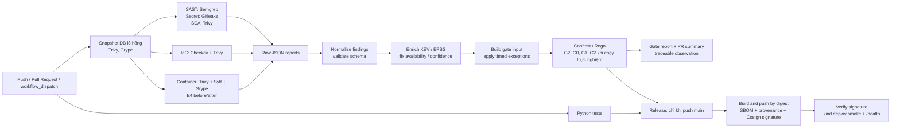

# Đề tài 21 - DevSecOps

**Tên đề tài:** Xây dựng đường ống DevSecOps phát hiện cấu hình sai và lỗ hổng trước triển khai

**Học phần:** Điện toán đám mây - GVHD: TS. Lê Quốc Tuấn

**Nhóm:** Trần Hữu Tài (`tranhuultai`), Đỗ Ngọc Duy (`duy13-computer`), Hoàng Gia Long (`gialong611`)

## Bản nộp

| Tài liệu | Đường dẫn |
| --- | --- |
| Báo cáo | `DOCX/DeTai21_DevSecOps.docx` |
| Slide thuyết trình (theme UTH, có ghi chú người nói) | `PPTX/DeTai21_DevSecOps.pptx` |
| Gói bằng chứng thực nghiệm | [`Code/DevSecOps/tests/results/metrics/live-evidence-2026-11-16/`](Code/DevSecOps/tests/results/metrics/live-evidence-2026-11-16/README.md) |

`DOCX/bao_cao_do_an_DevSecOps.docx` và `PPTX/slide_thuyet_trinh_DevSecOps.pptx` là bản sinh tự động bằng
`Extra/build_report_docs.py` từ số liệu đợt sơ bộ, không phải bản nộp.

## Giới thiệu

Đề tài xây dựng một pipeline DevSecOps trên GitHub Actions nhằm phát hiện cấu hình sai và lỗ hổng trước khi triển khai.

Pipeline gồm 5 lớp kiểm tra:

- SAST
- Secret scanning
- SCA
- IaC scanning
- Container image scanning

Kết quả từ các công cụ được chuẩn hóa và đưa vào Security Gate. Gate quyết định `BLOCK`, `WARN` hoặc `INFO` theo các chính sách G0, G1 và G2.

## Công cụ

| Thành phần | Công cụ |
| --- | --- |
| CI/CD | GitHub Actions |
| SAST | Semgrep |
| Secret scanning | Gitleaks |
| SCA | Trivy, Grype |
| IaC scanning | Checkov, Trivy |
| Container image | Trivy, Syft, Grype |
| Policy | Conftest / Rego |
| Image signing | Cosign |
| Deploy test | kind |
| Kiểm chứng hạ tầng AWS | Terraform (`validate`, `test` với provider giả lập) |

## Thực nghiệm

Bộ dữ liệu thực nghiệm gồm:

- 28 lỗi gieo cài (D)
- 10 thay đổi sạch (C)
- 8 mẫu đối chứng (N)

Các thực nghiệm:

- **E1:** Đánh giá khả năng phát hiện
- **E2:** So sánh chính sách G0, G1 và G2 ở hai chế độ chấm (full và delta)
- **E3:** Đánh giá thời gian pipeline
- **E4:** Đánh giá ảnh hưởng của việc khắc phục đến image và SBOM

### Đợt đo chính thức (15/11/2026)

Đợt đo chạy trên kho thực nghiệm `gialong611/DevSecOps_Project` tại commit
`135606475be9d66842121135631d853a63c1e480`. Commit này cũng có trong kho nộp bài; mã và dữ liệu
của đợt đo được đồng bộ về qua PR #30. Toàn bộ kết quả, URL run và hash nằm trong
[`live-evidence-2026-11-16`](Code/DevSecOps/tests/results/metrics/live-evidence-2026-11-16/README.md).

| Thí nghiệm | Kết quả |
|---|---|
| E1 - scanner | 28/28 lỗi gieo cài có finding đúng tool/rule; 0/10 thay đổi sạch và 0/8 mẫu đối chứng có finding theo rule đích. Công cụ có phạm vi lớn nhất là Checkov (12/28). |
| E2 - chế độ full | G1 chặn 28/28 lỗi nhưng chặn nhầm 10/10 thay đổi sạch và 8/8 mẫu đối chứng. G2 chặn 23/23 lỗi tầng BLOCK, cảnh báo 5 lỗi tầng WARN, không chặn nhầm (0/10, 0/8). G0 không chặn mẫu nào. |
| E2 - chế độ delta | Chỉ xét blocker mới so với baseline. G1: TP/FN/FP/TN = 28/0/0/10, chặn trúng rule đích 27/28, chặn nhầm N 1/8. G2: 23/0/0/15, chặn trúng rule đích 22/23, chặn nhầm N 0/8. |
| E3 - cache pip | 5 lượt mỗi cấu hình; trung vị 111 s (cold) và 125 s (warm), warm chậm hơn 14 s (12,61 %); IQR 3 s/10 s; phút runner trung vị 3,45/3,63. Các job quét vẫn chạy song song. |
| E4 - image/SBOM | Trivy 4.486 → 206 bản ghi lỗ hổng (-95,4 %); CRITICAL 18 → 0; HIGH 804 → 47; SBOM 22.943 → 2.856 thành phần (-87,6 %). Cùng Python 3.13.18, Debian 13.7, amd64, Trivy 0.76.1 và DB snapshot. |

Các số E4 `18 → 0 CRITICAL` lấy từ cặp raw report before/after của cùng run
E4, không phải từ một report image đơn lẻ. Image được scan local và chưa có
registry manifest digest; tín hiệu KEV/EPSS trong phần độ nhạy của E4 là mô phỏng.
E1/E2 phản ánh fixture đã gieo cài, E3 chỉ thay đổi pip cache; không suy rộng các
kết quả này thành tỷ lệ production hoặc kết luận cache luôn làm chậm pipeline.

Hình tổng hợp của đợt đo được sinh từ gói bằng chứng, không gọi mạng:

```bash
python Code/DevSecOps/tests/plot_live_evidence.py            # tests/results/figures/live-2026-11-16/
python Code/DevSecOps/tests/plot_live_evidence.py --report --out <thư mục>   # khổ nhỏ dùng trong báo cáo
```

`SHA256SUMS.txt` của gói được tạo trên Windows: 8 tệp JSON/MD được băm ở dạng CRLF, còn
`README.md` và `PR_GATE_EVIDENCE.md` ở dạng LF. Kho lưu mọi tệp văn bản ở dạng LF
(`.gitattributes`), nên `sha256sum -c` trên Linux báo lệch 8 tệp; chuyển 8 tệp đó sang CRLF
(ví dụ `unix2dos`) trước khi kiểm thì cả 10 tệp đều khớp.

### Đợt đo sơ bộ (03-04/11/2026)

Các tệp ở gốc `Code/DevSecOps/tests/results/metrics/` (`so_lieu_bao_cao.csv`, `e1_*`, `e2_*`, `e3_*`,
`e4_*`, `hypotheses.csv`) là số liệu đợt sơ bộ trên kho nộp bài (run 41659076551 và 41698953799,
bộ đáp án tag `gt-v1`). Báo cáo chỉ dùng đợt này cho phần đợt chính thức không đo: so sánh chạy
tuần tự và song song (H3), kích thước image và CVE có bản vá (H4).

### Gate trên pull request và bảo vệ nhánh `main`

- **Kho nộp bài (kho này):** PR #21 (03/11/2026) mở SSH cho `0.0.0.0/0` bị gate G2 chặn đúng lỗi
  `CKV_AWS_24` ([run 41699096052](https://github.com/tranhuultai/012012303904_21_DevSecOps/actions/runs/41699096052))
  và được cho qua sau khi gỡ luật
  ([run 41699668185](https://github.com/tranhuultai/012012303904_21_DevSecOps/actions/runs/41699668185));
  báo cáo gate lưu ở `Code/DevSecOps/tests/results/raw/demo_20261103_pr21/`.
- **Ruleset `main` của kho này** (đọc qua API ngày 19/11/2026): bắt buộc pull request với 1 lượt
  duyệt của chủ sở hữu mã (CODEOWNERS), bỏ duyệt cũ khi có commit mới, duyệt lần push cuối và giải
  quyết hết thảo luận; bắt buộc check `gate (Conftest Rego)`; chặn xóa nhánh và force push. Hai tài
  khoản đang có quyền bỏ qua (`always`), nên PR bị BLOCK vẫn có thể được hai tài khoản này merge;
  báo cáo đề xuất gỡ quyền này (Giải pháp 2).
- **Kho thực nghiệm:** PR #1 gieo lỗi D01 bị G2 chặn
  ([run 43729980295](https://github.com/gialong611/DevSecOps_Project/actions/runs/43729980295)) và pass sau khi
  hoàn nguyên ([run 43730231762](https://github.com/gialong611/DevSecOps_Project/actions/runs/43730231762)).
  `PR_GATE_EVIDENCE.md` trong gói bằng chứng mô tả ruleset **Protect main** của kho thực nghiệm
  (sáu required check, 0 review, không bypass), không phải ruleset của kho này.

### Kiểm chứng phần AWS mà không tạo tài nguyên

Nhóm không có tài khoản AWS nên Terraform không được `apply`. Workflow `iac-validate.yml` có hai job:

- `terraform validate + test`: cài Terraform bản ghim (kiểm checksum), `terraform fmt`, `init` không
  backend, `validate` và `terraform test` với provider giả lập.
- `ec2 bootstrap (Ubuntu 24.04)`: chạy thật `Code/DevSecOps/infra/scripts/ec2_bootstrap.sh` trên runner; image đã ký
  của `main` phải chạy được và trả lời `/health`, image không có chữ ký của kho phải bị từ chối.

Lần chạy [44126623520](https://github.com/tranhuultai/012012303904_21_DevSecOps/actions/runs/44126623520)
(17/11/2026) đạt cả hai job. Cách này chưa chứng minh việc tạo tài nguyên thật, định tuyến ALB,
chứng chỉ, DNS và đường mạng ra Internet. Theo cấu hình hiện tại, security group của ứng dụng chỉ cho
egress cổng 5432 trong VPC, nên khi triển khai thật EC2 sẽ không tải được Docker, cosign và image từ
GHCR; cần mở egress 443 kèm ngoại lệ có thời hạn hoặc dùng registry trong VPC.

Quy trình thu thập/tổng hợp xem tại `Code/DevSecOps/tests/README.md`; tự đánh giá
mức hoàn thiện xem tại `PROJECT_COMPLETION.md`.

## Kiến trúc pipeline



Job quét chạy song song sau bước chuẩn bị snapshot DB; gate tổng hợp báo cáo scan, IaC và image.
`BLOCK` làm job gate thất bại; `WARN` vẫn cho job tiếp tục và được ghi vào báo cáo. Gate hiện chấm
G2 ở chế độ full cho mọi sự kiện; chế độ delta được tính khi phân tích thực nghiệm E2. KEV/EPSS lấy
từ tệp snapshot đã commit trong `security/kev/`. Release chỉ chạy khi push `main`, sau khi unit test
và gate thành công; deploy smoke xác minh chữ ký trước khi triển khai thử trên `kind`. Workflow và
quyền từng job được khai báo tại `.github/workflows/ci.yml`.

## Cấu trúc repository

```text
012012303904_21_DevSecOps/
├── .github/            CODEOWNERS, pull_request_template.md
│   └── workflows/      ci.yml, iac-validate.yml, experiments.yml, e3-orchestrate.yml, e3-timing.yml
├── Code/DevSecOps/     (+ Dockerfile, .dockerignore, REFERENCES.md)
│   ├── src/            app FastAPI: app/, test/, requirements.txt
│   ├── infra/  deploy/ Terraform AWS (quét, validate, test giả lập); manifest Kubernetes
│   ├── lab/            docker/Dockerfile.vuln (E4); workflows-vuln/ (mẫu để gieo D26-D28 bằng patch)
│   ├── rules/          semgrep/, conftest/: luật PHÁT HIỆN lỗi (đầu vào của máy quét)
│   ├── tools/  schemas/   script, tools/test/ (fixture); findings, exception, severity_map
│   ├── policy/         g0/ g1/ g2/: luật QUYẾT ĐỊNH chặn của gate
│   ├── security/  ground_truth/   exceptions.yaml, kev/; ground_truth.csv, patches/
│   └── tests/          script thí nghiệm, analysis.ipynb; results/{raw,metrics,figures,triage}/
├── DOCX/  PPTX/  Extra/
└── README.md  PROJECT_COMPLETION.md  requirements.txt
```

## Tài liệu khác

- Phiên bản công cụ và SHA action: `Extra/TOOL_VERSIONS.md`
- Hướng dẫn triển khai: `Extra/HUONG_DAN_TRIEN_KHAI.md`
- Tài liệu chính sách gate: `Code/DevSecOps/policy/README.md`
- Tài liệu bộ đáp án và ánh xạ CWE/CVE: `Code/DevSecOps/ground_truth/README.md`
- Tài liệu tham khảo và phạm vi CSA CCM/CIS/SLSA: `Code/DevSecOps/REFERENCES.md`
- Phân tích số liệu: `Code/DevSecOps/tests/analysis.ipynb`

## Kiểm nghiệm

```powershell
# Luật gate Rego (G0, G1, G2) và luật phát hiện workflow
powershell -ExecutionPolicy Bypass -File Code/DevSecOps/tests/run_policy_tests.ps1
conftest verify -p Code/DevSecOps/rules/conftest

# Unit test ứng dụng (chạy cùng lệnh trong CI)
python -m pytest -v Code/DevSecOps/src/test Code/DevSecOps/tests
```

Thu thập lại đợt đo chính thức (cần `gh` đã đăng nhập, chạy trong `Code/DevSecOps`):

```bash
python tests/run_fixture_matrix.py --ref main --out-dir tests/results/live-study --parallelism 4
python tests/run_fixture_matrix.py --ref main --skip-fixtures --e3-cold-repeats 5 --e3-warm-repeats 5 --out-dir tests/results/e3-live
```

Các script của đợt sơ bộ: E1-E3 tính từ `findings.csv`, `decisions.csv`, `runs.csv` trong
`tests/results/raw/`; E4 build và quét lại hai image trên máy cục bộ.

```powershell
python Code/DevSecOps/tests/e1_detection_effectiveness.py --policy g0
python Code/DevSecOps/tests/e1_detection_effectiveness.py --policy g1
python Code/DevSecOps/tests/e1_detection_effectiveness.py --policy g2
python Code/DevSecOps/tests/e2_policy_comparison.py
python Code/DevSecOps/tests/e3_pipeline_duration.py
python Code/DevSecOps/tests/e4_image_remediation.py
```
