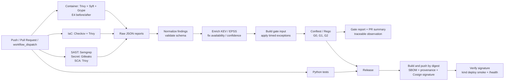

# Đề tài 21 – DevSecOps

**Tên đề tài:** Xây dựng đường ống DevSecOps phát hiện cấu hình sai và lỗ hổng trước triển khai

## Giới thiệu

Đề tài xây dựng một pipeline DevSecOps trên GitHub Actions nhằm phát hiện cấu hình sai và lỗ hổng trước khi triển khai.

Pipeline gồm 5 lớp kiểm tra:

- SAST
- Secret scanning
- SCA
- IaC scanning
- Container image scanning

Kết quả từ các công cụ được chuẩn hóa và đưa vào Security Gate. Gate quyết định `BLOCK`, `WARN` hoặc `INFO` theo các chính sách G0, G1 và G2.

## Công cụ

| Thành phần | Công cụ |
| --- | --- |
| CI/CD | GitHub Actions |
| SAST | Semgrep |
| Secret scanning | Gitleaks |
| SCA | Trivy, Grype |
| IaC scanning | Checkov, Trivy |
| Container image | Trivy, Syft, Grype |
| Policy | Conftest / Rego |
| Image signing | Cosign |
| Deploy test | kind |

## Thực nghiệm

Bộ dữ liệu thực nghiệm gồm:

- 28 lỗi gieo cài
- 8 mẫu đối chứng
- 10 thay đổi sạch

Các thực nghiệm:

- **E1:** Đánh giá khả năng phát hiện
- **E2:** So sánh chính sách G0, G1 và G2
- **E3:** Đánh giá thời gian pipeline
- **E4:** Đánh giá ảnh hưởng của việc khắc phục đến image và SBOM

### Kết quả thực nghiệm live mới nhất

Bộ E1–E4 được đo trên commit `135606475be9d66842121135631d853a63c1e480` và
được lưu tại
[`Code/DevSecOps/tests/results/metrics/live-evidence-2026-11-16/`](Code/DevSecOps/tests/results/metrics/live-evidence-2026-11-16/README.md).

| Thí nghiệm | Kết quả |
|---|---|
| E1 – scanner | 28/28 lỗi gieo cài có finding đúng tool/rule; 0/10 thay đổi sạch và 0/8 negative control có finding theo rule đích. |
| E2 – G1/G2 | G1: TP/FN/FP/TN = 28/0/0/10, target match 27/28, false-block N 1/8. G2: 23/0/0/15, target match 22/23, false-block N 0/8. G2 đánh WARN cho 5 lỗi được policy xếp dưới ngưỡng BLOCK. |
| E3 – cache pip | 5 lượt mỗi profile; wall median 111s cold, 125s warm (warm +14s / 12,61%); IQR 3s/10s; tổng runner-minutes median 3,45/3,63. Scanner vẫn chạy song song. |
| E4 – image/SBOM | Trivy 4.486 → 206 bản ghi lỗ hổng (-95,4%); CRITICAL 18 → 0; SBOM 22.943 → 2.856 thành phần (-87,6%). Cùng Python 3.13.18, Debian 13.7, amd64, Trivy 0.76.1 và DB snapshot. |

Các số E4 `18 → 0 CRITICAL` lấy từ cặp raw report before/after của cùng run
E4, không phải từ một report image đơn lẻ. Image được scan local và chưa có
registry manifest digest; T0 KEV/EPSS là mô phỏng. E1/E2 phản ánh fixture đã
gieo cài, E3 chỉ thay đổi pip cache; không suy rộng các kết quả này thành tỷ lệ
production hoặc kết luận cache luôn làm chậm pipeline. Xem các giới hạn và
đường dẫn run trong `PROJECT_COMPLETION.md` và thư mục evidence.

### Gate trên PR và bảo vệ nhánh

Các lượt CI trên nhánh PR chứng minh gate G2 chặn lỗi D01 và pass sau khi hoàn
nguyên lỗi. Ruleset **Protect main** hiện active trên `main`, yêu cầu PR và sáu
required checks:
`Prepare Trivy and Grype vulnerability DB snapshots`, `Run Python tests`,
`Security scans (collection mode)`, `iac`, `image`, `gate (Conftest Rego)`.
Lượt CI cuối có sáu check pass, nhưng PR #1 merge trước thời điểm ruleset được
tạo; cần một PR mới sau khi bật ruleset để chứng minh chặn merge thực tế. Cấu
hình yêu cầu 0 review và không bắt buộc nhánh cập nhật trước khi merge; chi tiết ở
[`PR_GATE_EVIDENCE.md`](Code/DevSecOps/tests/results/metrics/live-evidence-2026-11-16/PR_GATE_EVIDENCE.md).

Quy trình thu thập/tổng hợp xem tại `Code/DevSecOps/tests/README.md`; tự đánh giá
mức hoàn thiện xem tại `PROJECT_COMPLETION.md`.

## Kiến trúc pipeline



Job quét chạy song song; gate tổng hợp báo cáo scan, IaC và image. `BLOCK` làm
job gate thất bại; `WARN` vẫn cho job tiếp tục và được ghi vào báo cáo. Release
chạy sau khi unit test và gate job thành công; deploy smoke xác minh chữ ký
trước khi triển khai thử trên `kind`. Workflow và quyền từng job được khai báo
tại `.github/workflows/ci.yml`.

## Cấu trúc repository

```text
DevSecOps_Project/
├── .github/            CODEOWNERS, pull_request_template.md, workflows/ci.yml
├── Code/DevSecOps/     (+ pytest.ini, Dockerfile, .dockerignore khi có)
│   ├── src/            app FastAPI: app/, test/, requirements.txt
│   ├── infra/  deploy/ Terraform (chỉ quét); manifest Kubernetes
│   ├── lab/            docker/Dockerfile.vuln (E4); workflows-vuln/ (mẫu để gieo D26–D28 bằng patch)
│   ├── rules/          semgrep/, conftest/: luật PHÁT HIỆN lỗi (đầu vào của máy quét)
│   ├── tools/  schemas/   script, tools/test/ (fixture); findings, exception, severity_map
│   ├── policy/         g0/ g1/ g2/: luật QUYẾT ĐỊNH chặn của gate
│   ├── security/  ground_truth/   exceptions.yaml, kev/; ground_truth.csv, patches/
│   └── tests/          script thí nghiệm, analysis.ipynb; results/{raw,metrics,triage}/ và runs, findings, decisions .csv
├── DOCX/  PPTX/  Extra/
└── README.md  requirements.txt  .gitignore  .gitattributes  (+ .gitleaks.toml khi có)
```

## Tài liệu

- Báo cáo: `DOCX/bao_cao_do_an_DevSecOps.docx` (sinh lại bằng `python Extra/build_report_docs.py`; mặc định chỉ cập nhật DOCX)
- Slide: `PPTX/slide_thuyet_trinh_DevSecOps.pptx` (chỉ sinh lại khi gọi script với `--with-pptx`)
- Phiên bản công cụ và SHA action: `Extra/TOOL_VERSIONS.md`
- Tài liệu chính sách gate: `Code/DevSecOps/policy/README.md`
- Tài liệu bộ đáp án và ánh xạ CWE/CVE: `Code/DevSecOps/ground_truth/README.md`
- Tài liệu tham khảo và phạm vi CSA CCM/CIS/SLSA: `Code/DevSecOps/REFERENCES.md`
- Phân tích số liệu: `Code/DevSecOps/tests/analysis.ipynb`

## Kiểm nghiệm

```powershell
# Luật gate Rego (G0, G1, G2) và luật phát hiện workflow
powershell -ExecutionPolicy Bypass -File Code/DevSecOps/tests/run_policy_tests.ps1
conftest verify -p Code/DevSecOps/rules/conftest

# Unit test ứng dụng (chạy cùng lệnh trong CI)
python -m pytest -v Code/DevSecOps/src/test Code/DevSecOps/tests

# Thí nghiệm E1, E2, E3, E4
python Code/DevSecOps/tests/e1_detection_effectiveness.py --policy g0
python Code/DevSecOps/tests/e1_detection_effectiveness.py --policy g1
python Code/DevSecOps/tests/e1_detection_effectiveness.py --policy g2
python Code/DevSecOps/tests/e2_policy_comparison.py
python Code/DevSecOps/tests/e3_pipeline_duration.py
python Code/DevSecOps/tests/e4_image_remediation.py
```
