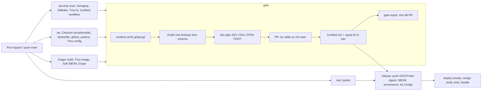

# Đề tài 21 – DevSecOps

**Tên đề tài:** Xây dựng đường ống DevSecOps phát hiện cấu hình sai và lỗ hổng trước triển khai

**Câu hỏi nghiên cứu:** Những kiểm soát tự động nào nên chặn bản phát hành, và ngưỡng nào chỉ nên
cảnh báo để không làm tê liệt quy trình phát triển?

## Tổng quan

Pipeline GitHub Actions chạy 5 lớp kiểm tra (SAST, secret, SCA, IaC, container image), chuẩn hóa kết
quả về một schema chung, làm giàu bằng CISA KEV và FIRST EPSS, rồi chấm bằng security gate viết bằng
Rego (Conftest). Ba chính sách được so sánh trên cùng bộ findings:

| Chính sách | Hành vi |
| --- | --- |
| G0 | Chỉ báo cáo, không chặn (mốc đo nhiễu) |
| G1 | Chặn mọi finding từ MEDIUM trở lên |
| G2 | Chặn secret, CVE thuộc KEV hoặc có EPSS ≥ 0,10, CVE CRITICAL/HIGH có bản vá, cấu hình thuộc danh mục kiểm soát tác động cao, SAST CRITICAL/HIGH; finding khác từ MEDIUM trở lên chỉ cảnh báo |

Ngoại lệ (`Code/DevSecOps/security/exceptions.yaml`) bắt buộc có chủ sở hữu, người duyệt khác chủ
sở hữu, lý do và ngày hết hạn trong trần theo mức độ (CRITICAL 7, HIGH 30, MEDIUM/LOW 90 ngày); ngoại
lệ hợp lệ miễn được mọi luật chặn của G2 trừ secret. Pull request được chấm theo chế độ delta (chỉ
finding mới so với lần quét gần nhất trên `main`). Job `gate` vẫn chạy và báo đỏ khi một job quét lỗi;
`release` chỉ chạy khi `test` và `gate` đạt.

| Lớp | Công cụ |
| --- | --- |
| SAST | Semgrep (luật tự viết `rules/semgrep` và bộ luật registry `p/python`) |
| Secret | Gitleaks |
| SCA | Trivy (filesystem) |
| IaC, Kubernetes, Dockerfile, workflow | Checkov, Trivy config, Conftest (`rules/conftest`) |
| Container image | Trivy image, Syft (SBOM), Grype |
| Gate | Conftest, OPA Rego v1 (`policy/g0`, `g1`, `g2`) |
| Chuỗi cung ứng | Cosign keyless, GitHub attestation (SLSA provenance), GHCR theo digest |
| Triển khai thử | kind, `cosign verify` trước khi deploy |

Phiên bản công cụ và SHA của GitHub Action: `Extra/TOOL_VERSIONS.md`.

## Kiến trúc pipeline



Ranh giới tin cậy: runner GitHub-hosted (mã và báo cáo), GHCR (image theo digest), Sigstore (Fulcio
cấp chứng chỉ từ OIDC của workflow, Rekor lưu bản ghi chữ ký). Mỗi job chỉ xin quyền cần thiết; mọi
action ghim SHA 40 ký tự, binary tải về được kiểm checksum.

## Thực nghiệm

| Mã | Câu hỏi | Workflow / script |
| --- | --- | --- |
| E1 | Mỗi công cụ bắt được bao nhiêu lỗi gieo cài, báo nhầm bao nhiêu | `.github/workflows/experiments.yml` (ma trận 47 mẫu) |
| E2 | G0/G1/G2 ở chế độ full và delta chặn đúng, chặn nhầm ra sao | cùng run E1, `tests/eval_policies.py` chạy Conftest thật |
| E3 | Cache và chạy song song rút ngắn pipeline bao nhiêu | `.github/workflows/e3-orchestrate.yml` gọi `e3-timing.yml` |
| E4 | Image trước/sau khắc phục khác nhau thế nào (SBOM, CVE, KEV) | job `e4-image` trong `experiments.yml` |

Bộ đáp án (`Code/DevSecOps/ground_truth/`): 28 lỗi gieo cài D01–D28, 8 mẫu đối chứng N01–N08,
10 thay đổi sạch C01–C10, mỗi mẫu là một patch áp độc lập trên cùng baseline. Rule ID chấp nhận,
tệp đích, lớp phát hiện, tầng G2 kỳ vọng và cách sửa nằm trong `ground_truth.csv`; bộ đáp án và
giả thuyết H1–H4 (`Code/DevSecOps/tests/README.md`) được đóng băng ở tag `gt-v1` trước lần chạy chính thức.

Dữ liệu thô của mỗi lần chạy nằm ở `Code/DevSecOps/tests/results/raw/exp_<ngày>_<run_id>/` và
`e3_<ngày>_<run_id>/` (kèm URL run GitHub Actions); bảng, biểu đồ và `so_lieu_bao_cao.csv` sinh lại bằng
`python Code/DevSecOps/tests/analyze_results.py` vào `tests/results/metrics/` và `tests/results/figures/`.

## Minh chứng gate trên pull request

[PR #21](https://github.com/tranhuultai/012012303904_21_DevSecOps/pull/21) thêm luật mở cổng 22 cho `0.0.0.0/0` vào `infra/security_groups.tf`: gate G2
(chế độ delta) trả BLOCK vì `CKV_AWS_24` ([run 41699096052](https://github.com/tranhuultai/012012303904_21_DevSecOps/actions/runs/41699096052)). Commit sửa
gỡ luật đó và gate trả PASS ([run 41699668185](https://github.com/tranhuultai/012012303904_21_DevSecOps/actions/runs/41699668185)). Báo cáo gate của hai run
nằm ở `Code/DevSecOps/tests/results/raw/demo_20261103_pr21/`.

## Tái lập

Yêu cầu: Python 3.13, Git, và các công cụ trong `Extra/TOOL_VERSIONS.md` nếu muốn quét tại máy.

```bash
# Môi trường và kiểm thử
python -m pip install -r requirements.txt
python -m pytest -q Code/DevSecOps/src/test Code/DevSecOps/tests
for g in g0 g1 g2; do conftest verify -p Code/DevSecOps/policy/$g; done
conftest verify -p Code/DevSecOps/rules/conftest
for p in Code/DevSecOps/ground_truth/patches/*.patch; do git apply --check "$p"; done

# Chạy thực nghiệm trên GitHub Actions
gh workflow run experiments.yml -f gt_ref=gt-v1
gh workflow run e3-orchestrate.yml -f reps=6

# Tạo lại bảng, biểu đồ và số liệu báo cáo từ dữ liệu thô
python Code/DevSecOps/tests/analyze_results.py
```

Terraform trong `infra/` chỉ dùng để quét tĩnh (`terraform init -backend=false` và `validate`), không
`apply`. Secret trong repo đều là giá trị giả: hiện chỉ nằm trong patch gieo lỗi (`.gitleaks.toml` bỏ
qua thư mục này); vài commit đầu từng có chuỗi giả trong `src/app/vulnerable_examples.py`, đã gỡ khỏi
baseline.

## Tài liệu bàn giao

| Tài liệu | Vị trí |
| --- | --- |
| Báo cáo (Word) | `DOCX/` |
| Slide thuyết trình | `PPTX/Slide_DeTai21_DevSecOps.pptx` |
| Hướng dẫn triển khai, tái lập, dọn tài nguyên, chi phí, rủi ro còn lại | [`Extra/HUONG_DAN_TRIEN_KHAI.md`](Extra/HUONG_DAN_TRIEN_KHAI.md) |
| Kịch bản demo và phân công trình bày | [`Extra/KICH_BAN_DEMO.md`](Extra/KICH_BAN_DEMO.md) |
| Sơ đồ kiến trúc, luồng dữ liệu, trình tự (nguồn và ảnh) | [`Extra/so_do/`](Extra/so_do/) |
| Phiên bản công cụ và action | [`Extra/TOOL_VERSIONS.md`](Extra/TOOL_VERSIONS.md) |
| Dữ liệu thô, số liệu báo cáo, notebook | `Code/DevSecOps/tests/results/`, `Code/DevSecOps/tests/analysis.ipynb` |

## Cấu trúc repository

```text
.github/                 CODEOWNERS, pull_request_template.md, workflows/ (ci, experiments, e3-timing, e3-orchestrate)
Code/DevSecOps/
├── src/                 ứng dụng FastAPI và unit test
├── Dockerfile           image ứng dụng (multi-stage, non-root, ghim digest)
├── infra/  deploy/      Terraform AWS (chỉ quét), manifest Kubernetes
├── lab/                 Dockerfile.vuln (E4), workflow mẫu sạch để gieo D07, D26–D28
├── rules/               luật phát hiện: semgrep/, conftest/ (workflow)
├── policy/              luật gate Rego g0/, g1/, g2/ và test
├── security/            exceptions.yaml, kev/ (snapshot KEV/EPSS)
├── schemas/             schema finding, gate_input, exception; severity_map.yaml
├── tools/               chuẩn hóa, làm giàu, gate input, delta, cài công cụ
├── ground_truth/        ground_truth.csv, patches/ (46 patch)
└── tests/               chạy quét, tổng hợp, chấm chính sách, E3, phân tích; results/
DOCX/  PPTX/  Extra/     báo cáo, slide, tài liệu kèm theo
```

## Nhóm

| Thành viên | GitHub | Phụ trách chính |
| --- | --- | --- |
| Trần Hữu Tài | `tranhuultai` | Hạ tầng, container, chuỗi cung ứng |
| Đỗ Ngọc Duy | `duy13-computer` | Ứng dụng, các lớp quét, workflow, chuẩn hóa |
| Hoàng Gia Long | `gialong611` | Gate Rego, bộ đáp án, thực nghiệm, phân tích |
