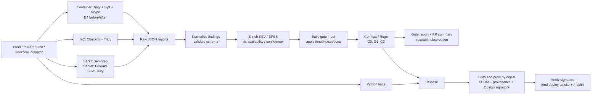

# Đề tài 21 – DevSecOps

**Tên đề tài:** Xây dựng đường ống DevSecOps phát hiện cấu hình sai và lỗ hổng trước triển khai

## Giới thiệu

Đề tài xây dựng một pipeline DevSecOps trên GitHub Actions nhằm phát hiện cấu hình sai và lỗ hổng trước khi triển khai.

Pipeline gồm 5 lớp kiểm tra:

- SAST
- Secret scanning
- SCA
- IaC scanning
- Container image scanning

Kết quả từ các công cụ được chuẩn hóa và đưa vào Security Gate. Gate quyết định `BLOCK`, `WARN` hoặc `INFO` theo các chính sách G0, G1 và G2.

## Công cụ

| Thành phần | Công cụ |
| --- | --- |
| CI/CD | GitHub Actions |
| SAST | Semgrep |
| Secret scanning | Gitleaks |
| SCA | Trivy, Grype |
| IaC scanning | Checkov, Trivy |
| Container image | Trivy, Syft, Grype |
| Policy | Conftest / Rego |
| Image signing | Cosign |
| Deploy test | kind |

## Thực nghiệm

Bộ dữ liệu thực nghiệm gồm:

- 28 lỗi gieo cài
- 8 mẫu đối chứng
- 10 thay đổi sạch

Các thực nghiệm:

- **E1:** Đánh giá khả năng phát hiện
- **E2:** So sánh chính sách G0, G1 và G2
- **E3:** Đánh giá thời gian pipeline
- **E4:** Đánh giá ảnh hưởng của việc khắc phục đến image và SBOM

**Trạng thái bằng chứng:** Run baseline #11 trên commit
`00e4f40f7488c6407e99c0076f03c0c0ba344d3c` đã thành công và lưu artifact
`report-scan`, `report-iac`, `report-image`, `report-gate` và `sbom` ([GitHub Actions run](https://github.com/gialong611/DevSecOps_Project/actions/runs/41283884525)).
Gate trả `WARN` với 275 findings, 0 blockers và 30 warnings (15 HIGH, 15 MEDIUM).
Ngưỡng hơn 20 warnings được đặt cho một PR; run này là `push`, nên chưa đo trực
tiếp độ nhiễu PR nhưng cho thấy baseline vượt ngân sách cảnh báo. Cần phân tích
raw reports và xử lý findings có căn cứ. Gate report/PR summary đã được cải tiến
để nối cảnh báo CVE/GHSA về finding nguồn, package, phiên bản đang cài, phiên bản
vá và vị trí; severity hiển thị theo policy thay vì gán mọi cảnh báo thành MEDIUM.
Thay đổi này làm cảnh báo có thể triage được nhưng chưa làm giảm số cảnh báo và
cần một CI run mới để ghi nhận tỷ lệ liên kết thực tế.
Job E4 báo delta sau remediation là -4,533 bản ghi lỗ hổng Trivy và -20,061
thành phần SBOM; số tuyệt đối, severity và image digest chưa được trích từ raw
artifact. Run này xác nhận pipeline chạy xuyên suốt; chưa đủ để kết luận recall,
false-positive rate hoặc thời gian đại diện vì chưa có toàn bộ fixture D/C/N và
các lượt lặp E3. Một observation truy vết được ghi thời gian ba job scan là
23s (security-scan), 32s (IaC) và 148s (image); 148s là đường găng của giai đoạn
scan song song trong một run, không phải tổng thời gian workflow. Các CSV/biểu
đồ đang commit vẫn là dữ liệu thiết kế/thăm dò,
không thay cho quan sát scanner thô theo fixture. E4 đã chạy trong workflow;
cần kiểm tra artifact trước/sau trước khi đưa delta vào metrics chuẩn. Quy trình
thu thập và tổng hợp: `Code/DevSecOps/tests/README.md`.
Xem bảng tự đánh giá và việc còn thiếu tại `PROJECT_COMPLETION.md`.

## Kiến trúc pipeline



Job quét chạy song song; gate tổng hợp báo cáo scan, IaC và image. `BLOCK` làm
job gate thất bại; `WARN` vẫn cho job tiếp tục và được ghi vào báo cáo. Release
chạy sau khi unit test và gate job thành công; deploy smoke xác minh chữ ký
trước khi triển khai thử trên `kind`. Workflow và quyền từng job được khai báo
tại `.github/workflows/ci.yml`.

## Cấu trúc repository

```text
DevSecOps_Project/
├── .github/            CODEOWNERS, pull_request_template.md, workflows/ci.yml
├── Code/DevSecOps/     (+ pytest.ini, Dockerfile, .dockerignore khi có)
│   ├── src/            app FastAPI: app/, test/, requirements.txt
│   ├── infra/  deploy/ Terraform (chỉ quét); manifest Kubernetes
│   ├── lab/            docker/Dockerfile.vuln (E4); workflows-vuln/ (mẫu để gieo D26–D28 bằng patch)
│   ├── rules/          semgrep/, conftest/: luật PHÁT HIỆN lỗi (đầu vào của máy quét)
│   ├── tools/  schemas/   script, tools/test/ (fixture); findings, exception, severity_map
│   ├── policy/         g0/ g1/ g2/: luật QUYẾT ĐỊNH chặn của gate
│   ├── security/  ground_truth/   exceptions.yaml, kev/; ground_truth.csv, patches/
│   └── tests/          script thí nghiệm, analysis.ipynb; results/{raw,metrics,triage}/ và runs, findings, decisions .csv
├── DOCX/  PPTX/  Extra/
└── README.md  requirements.txt  .gitignore  .gitattributes  (+ .gitleaks.toml khi có)
```

## Tài liệu

- Báo cáo: `DOCX/bao_cao_do_an_DevSecOps.docx` (sinh lại bằng `python Extra/build_report_docs.py`)
- Slide: `PPTX/slide_thuyet_trinh_DevSecOps.pptx` (cùng script trên)
- Phiên bản công cụ và SHA action: `Extra/TOOL_VERSIONS.md`
- Tài liệu chính sách gate: `Code/DevSecOps/policy/README.md`
- Tài liệu bộ đáp án và ánh xạ CWE/CVE: `Code/DevSecOps/ground_truth/README.md`
- Tài liệu tham khảo và phạm vi CSA CCM/CIS/SLSA: `Code/DevSecOps/REFERENCES.md`
- Phân tích số liệu: `Code/DevSecOps/tests/analysis.ipynb`

## Kiểm nghiệm

```powershell
# Luật gate Rego (G0, G1, G2) và luật phát hiện workflow
powershell -ExecutionPolicy Bypass -File Code/DevSecOps/tests/run_policy_tests.ps1
conftest verify -p Code/DevSecOps/rules/conftest

# Unit test ứng dụng (chạy cùng lệnh trong CI)
python -m pytest -v Code/DevSecOps/src/test

# Thí nghiệm E1, E2, E3, E4
python Code/DevSecOps/tests/e1_detection_effectiveness.py --policy g0
python Code/DevSecOps/tests/e1_detection_effectiveness.py --policy g1
python Code/DevSecOps/tests/e1_detection_effectiveness.py --policy g2
python Code/DevSecOps/tests/e2_policy_comparison.py
python Code/DevSecOps/tests/e3_pipeline_duration.py
python Code/DevSecOps/tests/e4_image_remediation.py
```
